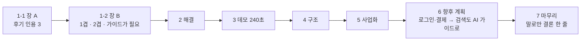

# 발표평가 10분 피치 초안 (v06 · r3)

- 작성: 2026-10-19 18:04~18:09 KST 초안 · 18:23 KST r1(6팀 r0 종합과 동원님 결정 반영) · 18:51 KST r2(최종 리뷰 2건과 동원님 추가 지시 반영) · story-architect · r3(동원님 8장 결정 3건 · prose-editor r2 · deck-reviewer r3 지적 반영 · 팀장)
- 기준 문서: `11_발표평가_10분피치_초안_v05_20261016.md`(v05, 보존). v05 는 고치지 않고 이 파일을 새로 만듦
- 이번 판에서 바꾼 것: 머리 · 시간 배분 · 1절 · 3절의 이미 결정된 삭제 2건 · 7절 신설 · 발표 전 점검
  - 2절 ~ 6절 본문은 v05 문장 그대로. 절 제목의 시간 표기만 바꿈(2절 90초 · 4절 50초)
  - r2 예외 두 곳: 2절 「흩어진 문제」 한 구절(final-review P1) · 6절 「다음 단계」를 두 단계로(동원님 추가 지시 10-19)
  - r3: 1-1 발표자 말 2줄(prose-editor r2 R2-4 · R2-5) · 2절 2겹 표현(R2-6) · 6절 장 제목 줄 추가와 「해석하는 도구」 발표자 말 삭제(동원님 결정 10-19)
  - 근거: 동원님 발화(10-19 슬라이드 r0 진단 중) 「아직 서비스 개선 작업이 진행중이라, 서비스에서의 디테일을 얘기한다거나 스샷을 넣는다거나 하면 그 부분은 일단 놔둬야 해.」(`team-reports/2026-10-19-slides/r0-synthesis.md` 6행 · 팀장 r1 지시)
- 대조한 슬라이드: r0 은 `13_발표슬라이드_v07_20261019/index.html`(sha256 `ff5c039d…1bccd2`) · r2 · r3 은 `15_발표슬라이드_v08_20261019/index.html`(최종 GO 판 sha256 `e9fa1e53…4493a`)
- 문제 제기 근거: `docs/60_본선준비/24_공매초보_어려움_커뮤니티조사_20261019.md`(아래에서 「근거 24」, 줄 번호는 이 파일 기준)
- 결정 기록: `team-reports/2026-10-19-slides/r0-synthesis.md` 6절(동원님 답변)
- 배정 시간: 발표 10분 + 질의응답 10분(2026-10-22 14:20~14:40). 데모 구간 240초 확정(동원님 실측)
- 자료 작성 규칙: 본문은 명사형으로 끝맺고, 나열은 불릿으로 쪼갬. 1절의 「화면에 올릴 글」 블록만 화면 문장(경어)
- 표기: 「」 안은 원문 그대로. [사실] 출처 확인 · [인용] 다른 문서에서 옮김 · [추정] 저자 판단 · [미확인] 확인 못 함

## 머리. 이 발표가 남길 것

- 결론 한 문장: 공매를 처음 하는 사람은 공고 읽기부터 낙찰 뒤 기한까지 챙길 것을 미리 알기 어렵고, OPADA 는 공고 주소 하나로 그것을 순서대로 보여 주는 준비 보조 가이드임
- 청중: 캠코(KAMCO) 심사위원. 온비드 운영 주체
  - 이미 아는 것: 공매 절차 · 용어 · 온비드 화면 · 온비드 FAQ 전부
  - 모르는 것: 처음 하는 이용자가 공고를 읽는 그 순간 실제로 어디서 막히는지
- 발표 뒤 바뀔 판단 한 줄: 「처음 하는 이용자가 온비드 원문을 끝까지 따라가게 돕는 보조 도구로 쓸모가 있다」
- 발표 유형: 미정(파일 이름은 「10분피치」). 유형별 분량 상한은 적용하지 않음
- 공개 범위: [미확인]. 확정 전까지 외부 공개 발표로 보고 씀(사내 정보 · 개인 식별자를 본문에 두지 않음)

## 시간 배분 (동원님 확정 · 2026-10-19)

| 절 | v05 | v06 확정 | 증감 | 장 수 |
|---|---|---|---|---|
| 0. 시작 페이지 | 10초 | 10초 | 0 | 1 |
| 1. 문제 | 70초 | 90초 | +20 | 2 |
| 2. 해결 | 150초 | 90초 | -60 | 1 |
| 3. 데모 시연 | 240초 | 240초 | 0(확정값) | 1 |
| 4. 시스템 구조 | 60초 | 50초 | -10 | 1 |
| 5. 사업화 | 70초 | 70초 | 0 | 1 |
| 6. 향후 계획 | 40초 | 40초 | 0 | 1 |
| 7. 마무리(신설 · 말로만) | 0초 | 10초 | +10 | 1 |
| 합계 | 640초 | 600초 | -40 | 9 |

- 확정 근거: `r0-synthesis.md` 81행 「해결 절을 줄임 (Recommended)」 · 75행 「2장으로 나눔 (Recommended)」
- v05 합계 640초는 10분(600초)을 40초 넘음 [사실]
  - 측정: `python3 -c "print(10+70+150+240+60+70+40)"` → `640`
  - v06 측정: `python3 -c "print(10+90+90+240+50+70+40+10)"` → `600`
- 남는 여유 0초

## 0. 시작 페이지 (10초)

- 서비스명: OPADA(OnBid Public Asset Doc Agent)
- 한 줄 소개: 온비드 공매·입찰 공고 주소 하나로 시작하는 AI 준비 가이드
- 발표: 데일컴퍼니 윤동원
- 2026 KAMCO Startup TechBlaze 결선 발표
- (v05 와 같음)
- 시각 증거 후보: 검토했고 글이 나음(v07 1장 그대로)

## 1. 문제 (90초 · 2장)

- 장 순서: 장 A(인용 장)가 먼저, 장 B(v03 제목 · 1겹 · 2겹)가 뒤(`r0-synthesis.md` 75~76행)
- 어려움의 원인은 처음 하는 사람에게 절차와 용어가 낯선 것으로 둠. 온비드 화면 · 공고 형식을 원인으로 두지 않음
  - 근거: v05 122행(캠코를 깎아내리는 표현 제거) · `r0-synthesis.md` B3

### 1-1. 장 A. 공매를 처음 하는 사람은 공고 읽기부터 낙찰 뒤 기한까지 챙길 것을 미리 알기 어려움 (50초)

- 주장 문장(장 제목): 「공매를 처음 하는 사람은 공고 읽기부터 낙찰 뒤 기한까지 챙길 것을 미리 알기 어렵습니다」
  - prose-editor R1-1(무엇을 처음 하는지 · 「공고 읽기를 미리 알다」의 어색함)
  - 근거: 근거 24 106~107행(「읽어도 결과를 모른다」 · 「낙찰 뒤 기한이 짧다」) [인용]
- 근거 불릿: 개인 후기 3개를 공고 읽기 → 유의사항 → 낙찰 뒤 순서로 놓음
  - 공고 읽기: 「매각공고 생각보다 꼼꼼히 봐야함」
    - 출처 표기(화면): 네이버 블로그 개인 후기 · 2026년
    - 근거 24 85행(limdl20 · 2026-02-12 · 글의 성격 「개인 체험」) [인용]
  - 유의사항: 「… 입찰 전 농취증이 뭔지도 몰랐던 나는 …」
    - 출처 표기(화면): 네이버 블로그 개인 후기 · 2024년
    - 풀이(화면): 농취증 = 농지취득자격증명(근거 24 84행 · 106행)
    - 근거 24 86행 · 175행(healthy_saludable · 2024-09-14 · 「개인 체험」) [인용]
    - 앞부분 「입찰 전에 주의사항에 알려주거등여 … 빨간 바탕으로 … 아무튼」은 「…」로 생략(`r0-synthesis.md` B6 · 원문 글자는 바꾸지 않음)
    - 발표자 말(화면 아님): 「이 후기를 쓴 분은 입찰 전에 빨간 바탕 주의사항을 안내받았지만, 농지취득자격증명이 무엇인지 몰랐다고 적었습니다. 같은 후기에는 이 서류를 제때 내지 않으면 낙찰이 취소되고 보증금을 돌려받지 못한다는 내용도 있습니다.」
      - 근거 24 86 · 106행 · prose-editor R2-N1. 생략한 앞부분이 칩 「유의사항」과 인용을 잇던 내용을 말로 메움(R1-2)
  - 낙찰 뒤: 「공매 잔금은 3천만원 미만이면 7일 안에 내야 합니다」
    - 출처 표기(화면): 네이버 블로그 개인 후기 · 2026년
    - 근거 24 84행(kashim2000 · 2026-09-23 · 「개인 체험」) [인용]
    - 후기를 쓴 사람이 적은 값이고, 공식 규정과의 대조는 [미확인]
    - 발표자 말(화면 아님): 「같은 후기에는 '소액이라고 방심하면 안 되는 부분'이라는 말도 있습니다. 후기를 쓴 분의 경우입니다.」 (인용 원문은 근거 24 107행 「소액이라고 방심하면 안 되는 부분」)
      - 근거 24 107행 [인용]
      - 「후기를 쓴 분의 경우」로 한정해 말함. 모든 공매에 맞는 규정처럼 말하지 않음(final-review P2 · 잔금 7일 공식 규정 미대조)
- 세 인용에서 말할 수 있는 공통점: 셋 다 입찰 전에 미리 알아 두어야 했던 것을 적음 [추정]
  - 「몰랐다」고 직접 적은 것은 유의사항 인용(healthy_saludable) 하나뿐. 나머지 둘로 일반화하지 않음
- 발표자 말(화면 아님): 같은 종류의 질문이 온비드 FAQ 에도 정리되어 있음. 처음 하는 사람이 흔히 묻는 질문이라는 방증으로만 말함 [추정]
  - FAQ #67964 「입찰결과에서 '유찰'의 의미」 · #107619 「매각결정통지서 및 잔대금납부영수증은 어디서 출력하나요?」(근거 24 98 · 100행) [인용]
  - 「FAQ 를 찾기 어렵다」로 읽힐 말은 하지 않음
- 시각 증거 후보: 인용 카드 3장을 공고 읽기 → 유의사항 → 낙찰 뒤 순서로 왼쪽부터 배치. 카드 아래 출처 한 줄(블로그 ID 미표기)

### 1-2. 장 B. 공매에 익숙하지 않은 사람에게는 친절한 AI 가이드가 필요함 (40초)

- 주장 문장(장 제목 · v03 확정): 「공매에 익숙하지 않은 사람에게는 친절한 AI 가이드가 필요합니다」(v07 `index.html` 728행)
- 층 순서: 첫 줄 → 1겹 · 2겹 카드 → 기한 띠 → 경고 띠(팀장 배치 · r2)
- 첫 줄: 후기와 초보 질문에 되풀이해 나오는 어려움을 두 가지로 묶음
  - 근거 24 187행(「여러 번 반복해서 보인 주제를 정성적으로 묶은 정리다」) · prose-editor R1-4(두 가지로 묶은 주체는 발표자 · 근거 24 는 다섯 갈래)
  - v05 18행 「대체로」는 뺀 상태 유지(빈도 미측정)
  - 질의응답 대비 발표자 말 한 줄: 「후기 6건 본문과 지식iN · 카페 질문을 정성적으로 묶었고, 빈도는 재지 않았습니다」(final-review P2 · 근거 24 9 · 187행)
- 1겹: 공매·입찰 **절차 자체가 아직 낯섦**
  - 전자입찰 방식과 서류 제출 시점, 다음 단계를 가늠하기 어려움(v05 19행 · v07 736행)
- 2겹: **무엇을 챙겨야 하는지 한눈에 알아보기 어려움**
  - 공고문을 읽어도 보증금·제출서류·기한 가운데 무엇이 내게 해당하는지 가려내기 힘듦
    - 근거: 근거 24 106행 · prose-editor R1-6 · `r0-synthesis.md` B3
  - v05 20행 「공고문·첨부문서·물건정보·입찰정보·보증금·제출서류를 하나씩 찾아 확인해야 함」은 뺌(온비드 화면 탓으로 읽힘)
- 낙찰 뒤 기한 띠: 낙찰 뒤에도 서류를 내야 하는 기한이 짧음. 후기에 적힌 농지취득자격증명(농취증) 제출 기한은 약 1주일
  - 근거 24 86행(「주어진 시간은 대략 1주일」) · 107행 [인용 · 후기 기재값 · 공식 대조 미확인] · prose-editor R1-7
  - 장 A 의 잔금 7일은 다시 말하지 않음
- 경고 띠: 두 어려움이 겹치면 기한을 놓치거나 서류를 빠뜨리기 쉬움. 무엇을 모르는지조차 모른 채 마감을 맞기도 함
  - 근거: v05 22~23행 · prose-editor S2-2 · S2-3 · N3 · R1-5(「두 부담」을 첫 줄과 같은 「어려움」으로)
  - v05 21행 「중도 포기」 · 22행 「비용 오해」는 뺌(근거 없음 · 받는 곳 없음 · `r0-synthesis.md` B2 · B4)
- 다음 장으로 넘기는 다리(발표자 말): 1겹은 순서대로 같이 가는 가이드가, 2겹은 정리가 받음(v05 28행 · v07 758행과 같은 구조)
- 시각 증거 후보: v07 2장의 1겹 · 2겹 카드 두 장 유지 + 기한 띠 + 경고 띠

### 1-3. 화면에 올릴 글 (slide-composer 용 · 그대로 옮김)

장 A

- 제목: 공매를 처음 하는 사람은 공고 읽기부터 낙찰 뒤 기한까지 챙길 것을 미리 알기 어렵습니다
- 카드 1 · 공고 읽기
  - 인용: 「매각공고 생각보다 꼼꼼히 봐야함」
  - 출처: 네이버 블로그 개인 후기 · 2026년
- 카드 2 · 유의사항
  - 인용: 「… 입찰 전 농취증이 뭔지도 몰랐던 나는 …」
  - 풀이: 농취증 = 농지취득자격증명
  - 출처: 네이버 블로그 개인 후기 · 2024년
- 카드 3 · 낙찰 뒤
  - 인용: 「공매 잔금은 3천만원 미만이면 7일 안에 내야 합니다」
  - 출처: 네이버 블로그 개인 후기 · 2026년

장 B

- 제목: 공매에 익숙하지 않은 사람에게는 친절한 AI 가이드가 필요합니다
- 첫 줄: 공매 후기와 초보 질문에 되풀이해 나오는 어려움을 두 가지로 묶었습니다.
- 1겹 카드
  - 이름: 공매·입찰 절차가 아직 낯섭니다
  - 설명: 전자입찰 방식과 서류 제출 시점을 알기 어렵습니다. 다음 단계를 가늠하기 힘듭니다.
- 2겹 카드
  - 이름: 무엇을 챙겨야 하는지 한눈에 알아보기 어렵습니다
  - 설명: 공고문을 읽어도 보증금·제출서류·기한 가운데 무엇이 내게 해당하는지 가려내기 힘듭니다.
- 기한 띠: 낙찰 뒤에도 서류를 내야 하는 기한이 짧습니다. 후기에 적힌 농지취득자격증명(농취증) 제출 기한은 **약 1주일**입니다.
- 경고 띠: 두 어려움이 겹치면 기한을 놓치거나 서류를 빠뜨리기 쉽습니다. 무엇을 모르는지조차 모른 채 마감을 맞기도 합니다.

- 출처 대응: 제목 R1-1 · 첫 줄 R1-4 · 1겹 설명은 v07 736행 그대로 · 2겹 설명 R1-6 · 기한 띠 R1-7(굵게는 「약 1주일」) · 경고 띠 R1-5 · 층 순서는 팀장 배치(r2)

### 1-4. 1절에서 쓰지 않는 것과 이유

- 권리분석 · 임차인 보증금 인수 · 입찰가 사례: 서비스가 하지 않는 범위(근거 24 168~170행 · 178행)
- 입찰서 제출 뒤 취소·변경 불가 인용(limdl20 「온라인이라 마감 전까지는 변경 가능할 줄 알았더니 안되더라」): 받는 기능이 미배포라 1:1 이 끊김(`r0-synthesis.md` 61행)
- 지식iN docId=182241499 인용: 작성 연도를 확인하지 못해 뺌(`r0-synthesis.md` 17행 · 63행 · 동원님 80행 선택)
- 생성형 AI 작성 의심 글(salstory365 2건 · steady_jh_38): 개인 사례로 쓰지 않음(근거 24 88~91행)
- 입찰 환경(공동인증서 · 가상계좌): 온비드 사이트 쪽 제약이고 서비스 범위 밖(근거 24 74행 · 160행)
- 2026-04 온비드 화면 개편 기사(근거 24 57행): 캠코 화면을 원인으로 읽힐 수 있어 쓰지 않음

- 이 아래 2절 ~ 6절 본문은 v05 25~95행을 그대로 옮김. 바꾼 것은 2절 · 4절 제목의 시간 표기와 3절의 이미 결정된 삭제 2건(v05 44 · 50행)뿐

## 2. 해결. 나만의 AI 공매 가이드가 있다면? (90초)

- 핵심 전환: 요약 도구에서 **공매를 몰라도 끝까지 같이 가는 가이드**로
  - 절차를 모르는 사람(문제 1겹)은 순차 가이드가, 이 공고에서 무엇을 챙겨야 하는지 알아보기 어려운 점(문제 2겹)은 자동 정리가 각각 받는다
- 입력 단계(마법사형 3단계)
  1. 내 유형·검토 목적 선택(초보/경험자, 임대/매각 등)
  2. 온비드 공고 URL 입력
  3. 분석 결과 확인(핵심 정보·확인 사항·온비드 연결, 세 묶음으로 정리)
- 준비 보드(순차 3단계, 앞 단계를 끝내야 다음이 열림)
  1. **공고 확인**: 입찰기간 만료·목적 불일치를 감지해 경고, "처음으로" 재시작 분기
  2. **서류 준비**: 공동입찰·대리입찰 여부를 질문으로 받아 서류 리스트를 자동 조건화, "내 보관함" 저장
  3. **입찰 참여**: 입찰기간·장소·최저입찰가격 등 참여 전 챙길 정보 리스트, **AI 질문창**
- AI 질문창
  - 이 공고에 대한 사실 질문 → 공고 원문 기반 답변
  - 공매 절차 일반 질문(전자입찰 진행 방식 등, 이 공고에 매이지 않은 것) → 일반 절차 지식으로 답변
  - 안전 경계 그대로 유지: 낙찰 가능성·적정가·법적 판단에는 답하지 않고 원문·담당기관 확인 안내

## 3. 데모 시연 (240초, 4분)

- 라이브 링크: `https://suzuki-suse-bush-dictionaries.trycloudflare.com`
- 시연 순서(동원님 시뮬레이션 기준)
  1. 유형·목적 선택 → URL 입력 → 분석 결과 확인
  2. 준비 보드 1단계(공고 확인) → 2단계(서류 준비, 공동입찰/대리입찰 질문 → 서류 리스트 변화) → 3단계(입찰 참여)
  3. AI 질문창에 실제 질문 1~2개(공고 사실 질문 + 공매 절차 일반 질문)

## 4. 시스템 구조 (50초)

- "방금 보신 기능을 구현하기 위해 서비스 구조는 이렇게 만들었습니다"
- 실제 시스템 객체를 중심으로 구성하고, 그 위에 서비스·데이터 흐름을 화살표로 보조 표시(슬라이드에서는 다이어그램으로 시각화)
  - **데이터 출처 3개**(독립된 외부 시스템): 온비드 공개 원문 HTML(기본 경로), 온비드 내부 JSON 엔드포인트(회차별 입찰기간 등 공식 문서화 API로는 못 받는 값), 공공데이터포털 온비드 API(보조 경로, 원문과 교차 대조)
  - **서버**: 세 출처에서 데이터를 받아 교차 대조한다. 내부에 **AI 계층**(`/api/ask`)을 둔다. AI 계층은 공고 사실·준비 보드 상태·공매 절차 일반 지식 세 근거를 받아 안전 경계가 박힌 프롬프트로 Gemini/Vertex 모델을 호출
  - **클라이언트**: 브라우저에서 동작하는 단일 페이지 앱. 마법사·준비 보드·AI 질문창 전부 하나의 화면 안에서 상태 전환한다. 내부에 **localStorage**를 둬 로그인 체계 없이 "내 보관함"·"관심 공고"를 보관
  - 화살표는 세 출처에서 서버로 데이터가 모이는 흐름과, 서버·클라이언트 사이에 공고 URL 요청과 분석 결과·AI 응답이 오가는 흐름을 보조로 표시
- 차별점: 단순 LLM 요약이 아니라 원문 파싱, 공공데이터, 내부 API 세 소스를 교차 대조한 뒤에만 AI가 답한다

## 5. 사업화 (70초)

- ⚠️ 가격·시장 규모는 동원님이 직접 제시한 상향식 로직으로 전면 재설계한 값이다(기존 v04의 가격 범위 역산 방식을 대체). 등기부등본 발급 비용 실측(700~1,000원, 20번 문서)과 온비드 월평균 입찰참가자 수 실측(14,034명, 21번 문서)을 근거로 삼는다. 응찰인 10배 추정·평균 월 10건 분석·시장침투율 1%→3% 세 가정은 추가 실증 근거 없이 설정한 값이다. 발표 시 "가정 기반 추정"임을 명시할 것
- 타깃 고객
  - 온비드 입찰 경험이 적은 개인
  - 공공자산을 사업 기회로 검토하는 소상공인·자영업자
  - 공공자산 활용 예비·초기 창업자
  - 창업지원기관·컨설턴트·액셀러레이터(기관용 반복 수요)
- 가격 체계(새 로직)
  - 건별 리포트: 5,000원에 3건 패키지(건당 약 1,667원). 등기부등본 발급 비용과 비슷한 수준으로 물건 정보를 정리해 드린다는 포지셔닝
  - 구독 베이직: 10,000원에 월 10건(건당 1,000원)
  - 구독 프로: 21,000원에 월 30건(건당 700원, 베이직 대비 30% 할인)
  - 구독 기관: 50,000원에 월 100건(건당 500원, 베이직 대비 50% 할인)
  - 상위 플랜일수록 건당 단가가 낮아지는 기존 원칙을 유지함
- 시장 규모(상향식 재계산)
  - 온비드 월평균 입찰참가자 수 약 14,000명(최근 3년 실측 기준)을 공매 응찰인 수로 간주
  - 분석만 해보는 사람(응찰까지 안 가는 사람)을 응찰인의 10배로 가정 → 140,000명/월
  - 140,000명이 월 평균 10건씩 분석한다고 가정 → 전체 물건분석 수요 1,400,000건/월
  - 초기 시장침투율 1% 가정 → OPADA 월간 처리량 14,000건/월
  - 14,000건 중 절반(7,000건)은 건별 패키지, 절반(7,000건)은 구독으로 커버된다고 가정
  - 건별 매출: 7,000건 ÷ 3건 = 2,333개 패키지 × 5,000원 = 약 1,167만 원/월
  - 구독 매출: 7,000건 ÷ 10건 = 700명 × 10,000원 = 700만 원/월
  - 월 합계 약 1,867만 원, 연매출(SOM, 초기 시장침투율 1% 기준) 약 2억 2,400만 원/년
  - SAM(시장침투율 3% 목표 반영): SOM의 3배, 약 6억 7,200만 원/년

## 6. 향후 계획 (40초)

- 장 제목(화면): 「로그인·결제를 붙인 뒤, 찾아주는 도구로 넓힙니다」(동원님 결정 10-19 · 앞 제목 「지금은 해석하는 도구, 다음은 찾아주는 도구」를 바꿈 · final-review-r2 P1)
- 현재 범위: 사용자가 온비드에서 직접 물건을 찾아 **링크를 복사해 와야** 시작됨(입력부터 시작하는 범위로 의도적으로 좁힘)
- 다음 단계(두 단계 · 순서대로 · 동원님 추가 지시 10-19)
  1. **통합 로그인(SSO)·결제 모듈 연동**
     - 화면 글: 「회원 로그인과 요금제 결제를 붙여 유료 서비스로 운영합니다.」(팀장 문구)
     - 5절 가격 체계(건별 · 구독)로 실제 결제를 받기 시작하는 단계로 앞 절과 이음 [추정]
  2. **검색 모듈도 AI 가이드로**: **AI 챗봇 기반 물건 검색**으로 확장
     - 화면 글: 「지역·가격대·재산유형을 말하면 AI가 후보 물건을 찾아 이 가이드로 연결합니다.」(팀장 문구)
     - 사용자가 조건(지역·가격대·재산유형)을 자연어로 말하면 AI가 온비드에서 후보 물건을 찾아 바로 이 가이드로 연결
     - 다음은 "원하는 공고를 찾아주는" 도구로 넓힘
  - 발표자 말: 로그인과 결제를 먼저 붙이고, 그다음 검색 모듈도 AI 가이드로 잘 만들어 보겠다는 순서로 말함(동원님 발화 「그거 한다음 검색 모듈 붙이기도 ai가이드로 잘 해보겠습니다」)
  - 서비스 디테일(로그인 방식 · 결제 수단 · 검색 화면)은 더하지 않음(동원님 같은 발화)
- 그 외 백로그
  - "내 보관함" 저장 데이터의 재방문 복원(현재는 저장만 되고 불러오기 미구현)
  - 서류 체크리스트 조건 축 확장(현재는 공동입찰·대리입찰 두 가지만 질문)

## 7. 마무리 (10초 · 신설 · 말로만)

- 발표자 말: 오늘의 결론 하나 「공고를 읽어도 다음이 보이지 않는 사람에게, 온비드 원문을 끝까지 따라가게 돕는 준비 가이드」 [추정 · 머리의 결론 한 문장을 줄인 것]
- 화면: 마지막 장은 「감사합니다 · 질의응답」. 결론 줄을 더하지 않음(`r0-synthesis.md` 84~85행 · 동원님 확정(10-19))
  - v07 8장 954행의 영문 약어는 「질의응답」으로 바꿈(`r0-synthesis.md` A1 · 83행)
- 질의응답에서 경계 질문이 오면 권장 문장: 「본 서비스는 입찰 여부, 법률 판단, 투자수익률, 낙찰 가능성을 제공하지 않으며, 온비드 원문과 담당기관 확인을 우선하는 준비 보조 도구입니다.」(CLAUDE.md 「발표·시연 금지표현」)
- 시각 증거 후보: 검토했고 글이 나음(「감사합니다 · 질의응답」)

## 구조 그림

---

## 발표 전 점검(슬라이드 내용 아님)

- 인용 3개를 근거 24 의 원문과 글자 대조(팀장 `check-transcription.py`)
  - 근거 24 189행대로 커뮤니티 원문 파일이 레포에 없음. 대조 기준은 근거 24 의 「」 안 글자
- 화면 문자열 금지표현 재검사(CLAUDE.md 목록 · 띄어쓰기 변형 포함 · known-pitfalls.md:66)
- 발표 당일 라이브 링크 접속 1회 확인(화면 경고 문구는 두지 않음 · v06 결정)
- v05 101행 모델 은퇴 위험: `gemini-3.1-flash-lite` 교체 · 배포 커밋 `d827c62` 로 해소되었다고 기록됨(v07 `notes.md` 「v06」 1번) [인용]
- 데모의 공매 절차 일반 질문이 「담당기관 문의 필요」로 빠질 수 있음(`r0-synthesis.md` 53행 · deck-reviewer #16 · 화면 동작 [미확인]). 발표 전 같은 질문 1회로 확인
- 「세 소스를 교차 대조한 뒤에만 AI 가 답한다」는 질의응답에서 물을 수 있음(`r0-synthesis.md` 54행 · deck-reviewer #12)
- 화면 · 말에서 블로그 ID · 카페 ID · docId 를 쓰지 않음
- 잔금 납부 기한(3천만 원 미만 7일)과 농취증 제출 기한을 공식 규정에서 1회 조회(final-review P2)

## 부록: v05 대비 변경점

| 항목 | v05(2026-10-16) | 본 원고(v06 r2, 2026-10-19) | 출처 |
|---|---|---|---|
| 머리 | 없음 | 결론 한 문장 · 청중 가정 · 바뀔 판단 · 유형 미정 · 공개 범위 미확인 | story-architect 작성 규칙 |
| 시간 합계 | 640초(10분 초과) | 600초 | 동원님 확정(10-19) |
| 1. 문제 시간 · 장 | 70초 · 1장 | 90초 · 2장(장 A 인용 → 장 B 정리) | 동원님 확정(10-19) |
| 1. 근거 | 주장만 있음 | 개인 후기 인용 3개(2026 · 2024 · 2026) · FAQ 문항은 발표자 말로만 | 근거 24 84 · 85 · 86 · 98 · 100 · 175행 |
| 1. 첫 줄 | 「대체로 두 가지 부담」 | 「후기와 초보 질문에 되풀이해 나오는 어려움을 두 가지로 묶음」 | S2-1 · N2 · R1-4 |
| 1. 2겹 설명 | 「공고문·첨부문서·…를 하나씩 찾아 확인해야 함」 | 「보증금·제출서류·기한 가운데 무엇이 내게 해당하는지 가려내기 힘듦」 | S2-4 · B3 · R1-6 |
| 1. 결과 | 「중도 포기」 · 「비용 오해」 | 뺌. 「두 어려움이 겹치면 기한을 놓치거나 서류를 빠뜨리기 쉬움」 | S2-2 · S2-3 · N3 · B2 · B4 · R1-5 |
| 1. 낙찰 뒤 기한 | 없음 | 장 A 잔금 7일(인용) · 장 B 농취증 약 1주일(띠) | 근거 24 84 · 86 · 107행 |
| 1. 쓰지 않는 것 | 없음 | 1-4 절 신설 | 근거 24 · `r0-synthesis.md` |
| 2. 해결 | 150초 | 90초. 본문은 v05 그대로이고 「흩어진 문제」 한 구절만 「무엇을 챙겨야 하는지 알아보기 어려운 점」으로 | 동원님 지시 · 확정(10-19) · final-review P1 |
| 3. 데모 | 인용구 · 링크 경고 있음 | 둘 다 뺌(이미 결정됨). 나머지는 v05 그대로 | v07 `notes.md` 「v06」 2 · 3번 |
| 4. 시스템 구조 | 60초 | 50초. 본문은 v05 그대로 | 동원님 확정(10-19) |
| 5절 | - | 바꾸지 않음 | - |
| 6. 향후 계획 | 다음 단계 하나(AI 챗봇 물건 검색) | 두 단계(① 통합 로그인(SSO)·결제 모듈 연동 → ② 검색 모듈도 AI 가이드로). 현재 범위 · 백로그는 그대로 · 40초 그대로 | 동원님 추가 지시(10-19) |
| 7. 마무리 | 없음 | 10초 신설 · 말로만 · 화면은 「감사합니다 · 질의응답」 | 동원님 확정(10-19) |
| 발표 전 점검 | 모델 은퇴 · 임시 터널 위험 | 인용 대조 · 금지표현 · 링크 1회 확인 · 모델 해소 기록 · 일반 질문 응답 확인 | `r0-synthesis.md` 3절 |

## 부록: 보류(서비스 디테일) 목록

동원님 지시(10-19)로 이번 판에서 고치지 않음. 노트 v05 문장과 v07 슬라이드가 어긋나는 곳만 적음 [관측].

| # | 노트 v05 (이 파일 2~6절에 그대로 둠) | v07 슬라이드 | 위치 |
|---|---|---|---|
| H1 | 준비 보드 「순차 3단계」 | 「4단계 (1~3단계 순차)」 | v05 33행 · v07 769행 |
| H2 | 2단계 「서류 준비」 | 3장 「입찰 전 준비」 · 4장 「서류 준비」 | v05 35 · 48행 · v07 772 · 809행 |
| H3 | 4단계 없음 | 「낙찰 후 준비 · 계약·소유권이전 서류를 따로 묶어 미리 보여 줌」 | v07 774행 |
| H4 | 「AI 질문창」 | 「AI 코치에게 물어보기」 · 배지 3종 | v05 36 · 37 · 49행 · v07 779~784행 |
| H5 | 「Gemini/Vertex 모델을 호출」 | 같은 표현 | v05 57행 · v07 869행 · `r0-synthesis.md` A3(동원님이 이번 수정에서 고르지 않음) |
| H6 | 「지금은 "가져온 공고를 해석"하는 도구」 | 「지금은 해석하는 도구」 | v05 92행 · v07 926행 · `r0-synthesis.md` C4 · r3 에서 8장 제목을 바꾸며 6절에서 뺌(동원님 결정) |
| H7 | 「서류 체크리스트 조건 축 확장」 | 「서류 체크리스트 조건 범위 확장」 | v05 95행 · v07 945행 · prose-editor N11 |
| H8 | 시장 규모 「초기 시장침투율 1% 기준」 | 「SOM · 초기 3년 목표」 | v05 84행 · v07 912행 · `r0-synthesis.md` C1 |

- r2 에서 고침: prose-editor N4 · final-review P1(v05 28행 「이 공고 정보가 흩어진 문제」 → 「이 공고에서 무엇을 챙겨야 하는지 알아보기 어려운 점」)
  - 서비스 디테일이 아니라 캠코 앞에서 온비드 탓으로 들리는 표현이라 고침(팀장 r2 지시). 2절의 다른 문장은 v05 그대로
- prose-editor N1(노트 전체를 경어로): 2 ~ 6절을 v05 그대로 두므로 적용하지 않음. 1-3 화면 글 블록만 경어

## 부록: r0 초안 대비 r1 변경점

| 항목 | r0 초안(18:04~18:09) | r1(18:23) | 출처 |
|---|---|---|---|
| 인용 · 공고 읽기 | 같음 | 같음 | 동원님 78행 |
| 인용 · 유의사항 | 앞부분 포함 전문 | 「… 입찰 전 농취증이 뭔지도 몰랐던 나는 …」 · 농취증 풀이 추가 | B6 · 동원님 79행 |
| 인용 · 낙찰 뒤 | 지식iN docId=182241499 | kashim2000 「공매 잔금은 3천만원 미만이면 7일 안에 내야 합니다」 | 동원님 80행 |
| 공통점 문장 | 「세 사람 모두 안내문은 읽었으나 …」 | 「셋 다 입찰 전에 미리 알아 두어야 했던 것을 적음」[추정] | B5 |
| 장 A 제목 | 「… 다음에 무엇이 오는지 모릅니다」 | 「… 공고 읽기부터 낙찰 뒤 기한까지 미리 알기 어렵습니다」 | 바뀐 낙찰 뒤 인용이 「모른다」가 아니라 기한을 말하므로 |
| 2겹 설명 | 「하나씩 확인해야 함」 유지 | 뺌 · S2-4 방향 | B3 |
| 비용 오해 | 언급 없음(v05 22행 잔존) | 뺌 | B4 |
| 기한 띠 | 잔금 7일 · 농취증 약 1주일 | 농취증 약 1주일만(잔금 7일은 장 A) | r1 지시 4 |
| 2 · 4절 본문 | v07 에 맞춰 고침 | v05 그대로 | 동원님 지시(10-19) |
| 3절 | v07 에 맞춰 일부 고침 | v05 에서 인용구 · 링크 경고만 삭제 | 동원님 지시(10-19) · v06 결정 |
| 7절 화면 | 결론 줄 추가 여부 확인 대상 | 더하지 않음 · 말로만 | 동원님 확정(10-19) |
| 시간 표 | 권고안 | 동원님 확정 | 동원님 81행 |

## 부록: r1 대비 r2 변경점

| 항목 | r1(18:23) | r2(18:51) | 출처 |
|---|---|---|---|
| 장 A 제목 | 「처음 하는 사람은 … 미리 알기 어렵습니다」 | 「공매를 처음 하는 사람은 … 챙길 것을 미리 알기 어렵습니다」 | R1-1 |
| 장 A 유의사항 카드 | 발표자 말 없음 | R2-N1 문장 추가 | R2-N1 · 근거 24 86 · 106행 |
| 장 A 낙찰 뒤 카드 | 발표자 말 없음 | 「소액이라고 방심하면 안 되는 부분」 · 「후기를 쓴 분의 경우」 한정 | final-review P2 · 근거 24 107행 |
| 장 B 첫 줄 | 「…두 가지 어려움이 되풀이해 나옵니다.」 | 「…되풀이해 나오는 어려움을 두 가지로 묶었습니다.」 | R1-4 |
| 장 B 질의응답 대비 | 없음 | 「후기 6건 본문과 지식iN · 카페 질문을 정성적으로 묶었고, 빈도는 재지 않았습니다」 | final-review P2 |
| 장 B 2겹 설명 | 띄운 나열 · 「고르기 어렵습니다」 | 붙인 나열 · 「가려내기 힘듭니다」 | R1-6 |
| 장 B 기한 띠 | 「…기한이 짧게 이어집니다. …농취증…」 | 「…서류를 내야 하는 기한이 짧습니다. …농지취득자격증명(농취증)… **약 1주일**」 | R1-7 |
| 장 B 경고 띠 | 「두 부담이 겹치면」 | 「두 어려움이 겹치면」 | R1-5 |
| 장 B 층 순서 | 경고 띠 → 기한 띠 | 기한 띠 → 경고 띠 | 팀장 배치 |
| 2절 | 「이 공고 정보가 흩어진 문제」 | 「이 공고에서 무엇을 챙겨야 하는지 알아보기 어려운 점」 | final-review P1 · N4 |
| 6절 다음 단계 | 하나(AI 챗봇 물건 검색) | 둘(통합 로그인(SSO)·결제 → 검색 모듈도 AI 가이드로) | 동원님 추가 지시(10-19) |
| 발표 전 점검 | - | 잔금 · 농취증 기한 공식 규정 1회 조회 | final-review P2 |
