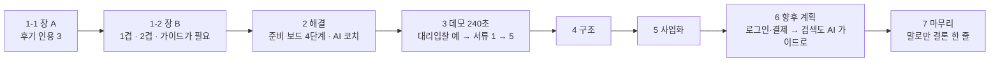

# 발표평가 10분 피치 초안 (v07 · r0)

- 작성: 2026-10-20 09:00 KST 착수 · 09:08 KST story-architect r0 초안(개선 모드 · develop `a1e1f3a` 기준) · r1(`date` 09:39:10 뒤 · 동원님 결정 4건 반영 · 팀장) · r2(`date` 10:22:34 · 최종 리뷰 r1 의 노트 지적 4건 · 라이브 실측 반영 · 팀장 · `team-reports/2026-10-20-slides-v09/fix-r2-list.md`) · r3(재판정 r2 반환 10:32:13 뒤 · 노트 지적 4건(바뀐 줄 5) · `team-reports/2026-10-20-slides-v09/prose-review-r2.md` R1 · R5 · R6 · `final-review-r2.md` P2-D · 팀장)
- 기준 판(r1): main `2f38609`(src 는 develop `2c46005` 와 같음 · 스크린샷 판 `a1e1f3a` 와의 src 차이는 「원문 근거」 출처 표시 1건). 결정 원문: `team-reports/2026-10-20-slides-v09/r0-synthesis.md` 6절
- 기준 문서: `14_발표평가_10분피치_초안_v06_20261019.md`(v06 · 보존 · sha256 `33c495ea…4983c`). v06 은 고치지 않고 이 사본을 고침
- 이번 판에서 바꾼 것: 머리 작성 줄 · 2절 해결 · 3절 데모 · 4절 시스템 구조 · 6절 백로그 두 줄 · 구조 그림 · 발표 전 점검 · 보류 목록 처분 · v06 대비 변경점 부록
  - 1절 · 5절 · 7절 본문과 시간 배분(합계 600초)은 v06 그대로
  - 근거: 동원님 지시(2026-10-20) 「가장 최근의 develop 브랜치를 기준으로, 슬라이드 업데이트해줘. 이제는 서비스 형상이나 디테일이 거의 완성됐다고 보면 돼.」(`team-reports/2026-10-20-slides-v09/r0-packet-common.md` 5행)
  - v06 의 보류 근거(10-19 「서비스에서의 디테일 … 그 부분은 일단 놔둬야 해」)는 이 지시로 풀림
- 서비스 사실의 출처: `team-reports/2026-10-20-slides-v09/service-facts-develop-a1e1f3a.md`(아래 「사실 파일」 · 팀장 실측 2026-10-20 08:54~08:56)
  - 코드는 `git show develop:src/app.js` · `git show develop:src/server.py`(develop = `a1e1f3a`). 줄 번호는 이 판 기준
  - 스크린샷 파일 이름(`01-step1-1.png` ~ `13-step2-1-terms.png`)은 사실 파일 머리의 폴더 기준
- 대조한 슬라이드: `17_발표슬라이드_v09_20261020/index.html`(v08 사본 · sha256 `e9fa1e53…4493a`)
- 문제 제기 근거: `docs/60_본선준비/24_공매초보_어려움_커뮤니티조사_20261019.md`(아래에서 「근거 24」, 줄 번호는 이 파일 기준)
- 결정 기록: `team-reports/2026-10-19-slides/r0-synthesis.md` 6절(동원님 답변)
- 배정 시간: 발표 10분 + 질의응답 10분(2026-10-22 14:20~14:40). 데모 구간 240초 확정(동원님 실측)
- 자료 작성 규칙: 본문은 명사형으로 끝맺고, 나열은 불릿으로 쪼갬. 1절의 「화면에 올릴 글」 블록만 화면 문장(경어)
- 표기: 「」 안은 원문 그대로. [사실] 출처 확인 · [인용] 다른 문서에서 옮김 · [추정] 저자 판단 · [미확인] 확인 못 함 · [관측] 화면이나 코드에서 직접 읽음

## 머리. 이 발표가 남길 것

- 결론 한 문장: 공매를 처음 하는 사람은 공고 읽기부터 낙찰 뒤 기한까지 챙길 것을 미리 알기 어렵고, OPADA 는 공고 주소 하나로 그것을 순서대로 보여 주는 준비 보조 가이드임
- 청중: 캠코(KAMCO) 심사위원. 온비드 운영 주체
  - 이미 아는 것: 공매 절차 · 용어 · 온비드 화면 · 온비드 FAQ 전부
  - 모르는 것: 처음 하는 이용자가 공고를 읽는 그 순간 실제로 어디서 막히는지
- 발표 뒤 바뀔 판단 한 줄: 「처음 하는 이용자가 온비드 원문을 끝까지 따라가게 돕는 보조 도구로 쓸모가 있다」
- 발표 유형: 미정(파일 이름은 「10분피치」). 유형별 분량 상한은 적용하지 않음
- 공개 범위: [미확인]. 확정 전까지 외부 공개 발표로 보고 씀(사내 정보 · 개인 식별자를 본문에 두지 않음)

## 시간 배분 (동원님 확정 · 2026-10-19)

| 절 | v05 | v06 확정 | 증감 | 장 수 |
|---|---|---|---|---|
| 0. 시작 페이지 | 10초 | 10초 | 0 | 1 |
| 1. 문제 | 70초 | 90초 | +20 | 2 |
| 2. 해결 | 150초 | 90초 | -60 | 1 |
| 3. 데모 시연 | 240초 | 240초 | 0(확정값) | 1 |
| 4. 시스템 구조 | 60초 | 50초 | -10 | 1 |
| 5. 사업화 | 70초 | 70초 | 0 | 1 |
| 6. 향후 계획 | 40초 | 40초 | 0 | 1 |
| 7. 마무리(신설 · 말로만) | 0초 | 10초 | +10 | 1 |
| 합계 | 640초 | 600초 | -40 | 9 |

- 확정 근거: `r0-synthesis.md` 81행 「해결 절을 줄임 (Recommended)」 · 75행 「2장으로 나눔 (Recommended)」
- v05 합계 640초는 10분(600초)을 40초 넘음 [사실]
  - 측정: `python3 -c "print(10+70+150+240+60+70+40)"` → `640`
  - v06 측정: `python3 -c "print(10+90+90+240+50+70+40+10)"` → `600`
- 남는 여유 0초

## 0. 시작 페이지 (10초)

- 서비스명: OPADA(OnBid Public Asset Doc Agent)
- 한 줄 소개: 온비드 공매·입찰 공고 주소 하나로 시작하는 AI 준비 가이드
- 발표: 데일컴퍼니 윤동원
- 2026 KAMCO Startup TechBlaze 결선 발표
- (v05 와 같음)
- 시각 증거 후보: 검토했고 글이 나음(v07 1장 그대로)

## 1. 문제 (90초 · 2장)

- 장 순서: 장 A(인용 장)가 먼저, 장 B(v03 제목 · 1겹 · 2겹)가 뒤(`r0-synthesis.md` 75~76행)
- 어려움의 원인은 처음 하는 사람에게 절차와 용어가 낯선 것으로 둠. 온비드 화면 · 공고 형식을 원인으로 두지 않음
  - 근거: v05 122행(캠코를 깎아내리는 표현 제거) · `r0-synthesis.md` B3

### 1-1. 장 A. 공매를 처음 하는 사람은 공고 읽기부터 낙찰 뒤 기한까지 챙길 것을 미리 알기 어려움 (50초)

- 주장 문장(장 제목): 「공매를 처음 하는 사람은 공고 읽기부터 낙찰 뒤 기한까지 챙길 것을 미리 알기 어렵습니다」
  - prose-editor R1-1(무엇을 처음 하는지 · 「공고 읽기를 미리 알다」의 어색함)
  - 근거: 근거 24 106~107행(「읽어도 결과를 모른다」 · 「낙찰 뒤 기한이 짧다」) [인용]
- 근거 불릿: 개인 후기 3개를 공고 읽기 → 유의사항 → 낙찰 뒤 순서로 놓음
  - 공고 읽기: 「매각공고 생각보다 꼼꼼히 봐야함」
    - 출처 표기(화면): 네이버 블로그 개인 후기 · 2026년
    - 근거 24 85행(limdl20 · 2026-02-12 · 글의 성격 「개인 체험」) [인용]
  - 유의사항: 「… 입찰 전 농취증이 뭔지도 몰랐던 나는 …」
    - 출처 표기(화면): 네이버 블로그 개인 후기 · 2024년
    - 풀이(화면): 농취증 = 농지취득자격증명(근거 24 84행 · 106행)
    - 근거 24 86행 · 175행(healthy_saludable · 2024-09-14 · 「개인 체험」) [인용]
    - 앞부분 「입찰 전에 주의사항에 알려주거등여 … 빨간 바탕으로 … 아무튼」은 「…」로 생략(`r0-synthesis.md` B6 · 원문 글자는 바꾸지 않음)
    - 발표자 말(화면 아님): 「이 후기를 쓴 분은 입찰 전에 빨간 바탕 주의사항을 안내받았지만, 농지취득자격증명이 무엇인지 몰랐다고 적었습니다. 같은 후기에는 이 서류를 제때 내지 않으면 낙찰이 취소되고 보증금을 돌려받지 못한다는 내용도 있습니다.」
      - 근거 24 86 · 106행 · prose-editor R2-N1. 생략한 앞부분이 칩 「유의사항」과 인용을 잇던 내용을 말로 메움(R1-2)
  - 낙찰 뒤: 「공매 잔금은 3천만원 미만이면 7일 안에 내야 합니다」
    - 출처 표기(화면): 네이버 블로그 개인 후기 · 2026년
    - 근거 24 84행(kashim2000 · 2026-09-23 · 「개인 체험」) [인용]
    - 후기를 쓴 사람이 적은 값이고, 공식 규정과의 대조는 [미확인]
    - 발표자 말(화면 아님): 「같은 후기에는 '소액이라고 방심하면 안 되는 부분'이라는 말도 있습니다. 후기를 쓴 분의 경우입니다.」 (인용 원문은 근거 24 107행 「소액이라고 방심하면 안 되는 부분」)
      - 근거 24 107행 [인용]
      - 「후기를 쓴 분의 경우」로 한정해 말함. 모든 공매에 맞는 규정처럼 말하지 않음(final-review P2 · 잔금 7일 공식 규정 미대조)
- 세 인용에서 말할 수 있는 공통점: 셋 다 입찰 전에 미리 알아 두어야 했던 것을 적음 [추정]
  - 「몰랐다」고 직접 적은 것은 유의사항 인용(healthy_saludable) 하나뿐. 나머지 둘로 일반화하지 않음
- 발표자 말(화면 아님): 같은 종류의 질문이 온비드 FAQ 에도 정리되어 있음. 처음 하는 사람이 흔히 묻는 질문이라는 방증으로만 말함 [추정]
  - FAQ #67964 「입찰결과에서 '유찰'의 의미」 · #107619 「매각결정통지서 및 잔대금납부영수증은 어디서 출력하나요?」(근거 24 98 · 100행) [인용]
  - 「FAQ 를 찾기 어렵다」로 읽힐 말은 하지 않음
- 시각 증거 후보: 인용 카드 3장을 공고 읽기 → 유의사항 → 낙찰 뒤 순서로 왼쪽부터 배치. 카드 아래 출처 한 줄(블로그 ID 미표기)

### 1-2. 장 B. 공매에 익숙하지 않은 사람에게는 친절한 AI 가이드가 필요함 (40초)

- 주장 문장(장 제목 · v03 확정): 「공매에 익숙하지 않은 사람에게는 친절한 AI 가이드가 필요합니다」(v07 `index.html` 728행)
- 층 순서: 첫 줄 → 1겹 · 2겹 카드 → 기한 띠 → 경고 띠(팀장 배치 · r2)
- 첫 줄: 후기와 초보 질문에 되풀이해 나오는 어려움을 두 가지로 묶음
  - 근거 24 187행(「여러 번 반복해서 보인 주제를 정성적으로 묶은 정리다」) · prose-editor R1-4(두 가지로 묶은 주체는 발표자 · 근거 24 는 다섯 갈래)
  - v05 18행 「대체로」는 뺀 상태 유지(빈도 미측정)
  - 질의응답 대비 발표자 말 한 줄: 「후기 6건 본문과 지식iN · 카페 질문을 정성적으로 묶었고, 빈도는 재지 않았습니다」(final-review P2 · 근거 24 9 · 187행)
- 1겹: 공매·입찰 **절차 자체가 아직 낯섦**
  - 전자입찰 방식과 서류 제출 시점, 다음 단계를 가늠하기 어려움(v05 19행 · v07 736행)
- 2겹: **무엇을 챙겨야 하는지 한눈에 알아보기 어려움**
  - 공고문을 읽어도 보증금·제출서류·기한 가운데 무엇이 내게 해당하는지 가려내기 힘듦
    - 근거: 근거 24 106행 · prose-editor R1-6 · `r0-synthesis.md` B3
  - v05 20행 「공고문·첨부문서·물건정보·입찰정보·보증금·제출서류를 하나씩 찾아 확인해야 함」은 뺌(온비드 화면 탓으로 읽힘)
- 낙찰 뒤 기한 띠: 낙찰 뒤에도 서류를 내야 하는 기한이 짧음. 후기에 적힌 농지취득자격증명(농취증) 제출 기한은 약 1주일
  - 근거 24 86행(「주어진 시간은 대략 1주일」) · 107행 [인용 · 후기 기재값 · 공식 대조 미확인] · prose-editor R1-7
  - 장 A 의 잔금 7일은 다시 말하지 않음
- 경고 띠: 두 어려움이 겹치면 기한을 놓치거나 서류를 빠뜨리기 쉬움. 무엇을 모르는지조차 모른 채 마감을 맞기도 함
  - 근거: v05 22~23행 · prose-editor S2-2 · S2-3 · N3 · R1-5(「두 부담」을 첫 줄과 같은 「어려움」으로)
  - v05 21행 「중도 포기」 · 22행 「비용 오해」는 뺌(근거 없음 · 받는 곳 없음 · `r0-synthesis.md` B2 · B4)
- 다음 장으로 넘기는 다리(발표자 말): 1겹은 순서대로 같이 가는 가이드가, 2겹은 정리가 받음(v05 28행 · v07 758행과 같은 구조)
- 시각 증거 후보: v07 2장의 1겹 · 2겹 카드 두 장 유지 + 기한 띠 + 경고 띠

### 1-3. 화면에 올릴 글 (slide-composer 용 · 그대로 옮김)

장 A

- 제목: 공매를 처음 하는 사람은 공고 읽기부터 낙찰 뒤 기한까지 챙길 것을 미리 알기 어렵습니다
- 카드 1 · 공고 읽기
  - 인용: 「매각공고 생각보다 꼼꼼히 봐야함」
  - 출처: 네이버 블로그 개인 후기 · 2026년
- 카드 2 · 유의사항
  - 인용: 「… 입찰 전 농취증이 뭔지도 몰랐던 나는 …」
  - 풀이: 농취증 = 농지취득자격증명
  - 출처: 네이버 블로그 개인 후기 · 2024년
- 카드 3 · 낙찰 뒤
  - 인용: 「공매 잔금은 3천만원 미만이면 7일 안에 내야 합니다」
  - 출처: 네이버 블로그 개인 후기 · 2026년

장 B

- 제목: 공매에 익숙하지 않은 사람에게는 친절한 AI 가이드가 필요합니다
- 첫 줄: 공매 후기와 초보 질문에 되풀이해 나오는 어려움을 두 가지로 묶었습니다.
- 1겹 카드
  - 이름: 공매·입찰 절차가 아직 낯섭니다
  - 설명: 전자입찰 방식과 서류 제출 시점을 알기 어렵습니다. 다음 단계를 가늠하기 힘듭니다.
- 2겹 카드
  - 이름: 무엇을 챙겨야 하는지 한눈에 알아보기 어렵습니다
  - 설명: 공고문을 읽어도 보증금·제출서류·기한 가운데 무엇이 내게 해당하는지 가려내기 힘듭니다.
- 기한 띠: 낙찰 뒤에도 서류를 내야 하는 기한이 짧습니다. 후기에 적힌 농지취득자격증명(농취증) 제출 기한은 **약 1주일**입니다.
- 경고 띠: 두 어려움이 겹치면 기한을 놓치거나 서류를 빠뜨리기 쉽습니다. 무엇을 모르는지조차 모른 채 마감을 맞기도 합니다.

- 출처 대응: 제목 R1-1 · 첫 줄 R1-4 · 1겹 설명은 v07 736행 그대로 · 2겹 설명 R1-6 · 기한 띠 R1-7(굵게는 「약 1주일」) · 경고 띠 R1-5 · 층 순서는 팀장 배치(r2)

### 1-4. 1절에서 쓰지 않는 것과 이유

- 권리분석 · 임차인 보증금 인수 · 입찰가 사례: 서비스가 하지 않는 범위(근거 24 168~170행 · 178행)
- 입찰서 제출 뒤 취소·변경 불가 인용(limdl20 「온라인이라 마감 전까지는 변경 가능할 줄 알았더니 안되더라」): 받는 기능이 미배포라 1:1 이 끊김(`r0-synthesis.md` 61행)
- 지식iN docId=182241499 인용: 작성 연도를 확인하지 못해 뺌(`r0-synthesis.md` 17행 · 63행 · 동원님 80행 선택)
- 생성형 AI 작성 의심 글(salstory365 2건 · steady_jh_38): 개인 사례로 쓰지 않음(근거 24 88~91행)
- 입찰 환경(공동인증서 · 가상계좌): 온비드 사이트 쪽 제약이고 서비스 범위 밖(근거 24 74행 · 160행)
- 2026-04 온비드 화면 개편 기사(근거 24 57행): 캠코 화면을 원인으로 읽힐 수 있어 쓰지 않음

- 이 아래 2 · 3 · 4절과 6절 백로그는 develop `a1e1f3a` 화면과 코드에 맞춰 v07 에서 다시 씀. 5절과 6절 앞부분(장 제목 · 현재 범위 · 다음 단계)은 v06 그대로

## 2. 해결. 나만의 AI 공매 가이드가 있다면? (90초)

- 장 제목(화면): 「나만의 AI 공매 가이드가 있다면?」(v06 그대로 · 질문형)
  - 제목은 바꾸지 않음(동원님 결정 10-20 · 5·6·7장 제목 「그대로 둠」과 같은 답)
- 핵심 전환: 요약 도구에서 **공매를 몰라도 끝까지 같이 가는 가이드**로(v06 그대로)
  - 절차를 모르는 사람(문제 1겹)은 단계별 준비 보드가, 이 공고에서 무엇을 챙겨야 하는지 알아보기 어려운 점(문제 2겹)은 공고 분석 결과가 돕는다(r2 · 화면 띠와 낱말을 맞춤 · prose-editor r1 N-r3)
  - 장 B 의 낙찰 뒤 기한 띠는 준비 보드 2-4 「낙찰 후 준비」가 받는다(v07 추가 · H3)
- 근거 1 · 공고 가져오기 3단계(1-1 ~ 1-3)
  1. 1-1 「내 유형과 목적을 입력해주세요」: 사용자 유형 4개(개인사업자 · 개인 · 법인 · 예비창업자) · 검토 목적 3개(임대/대부 · 매각/공매 · 창업 공간 탐색) [관측: 사실 파일 2절]
  2. 1-2 「온비드 공고 물건 URL을 입력해주세요」: 주소를 넣고 「분석하기」를 누르면 처리 단계 6줄(URL/조건 입력 → … → 준비 보드 생성)이 진행됨 [관측: 사실 파일 2절 · `02-step1-2.png`]
  3. 1-3 「분석 결과를 확인해주세요」: 「판정」 · 「핵심 정보」 · 「확인 사항」 · 「온비드 연결」 네 묶음 [관측: 사실 파일 2절 · `03-step1-3.png`]
     - v06 의 「세 묶음」에 develop 에서 「판정」이 앞에 더해짐
- 근거 2 · 준비 보드 4단계(2-2 · 2-3 은 앞 단계를 마쳐야 열림 · 2-4 는 잠그지 않고 미리 보여 줌)
  1. **2-1 공고 확인**: 공고 유형 · 입찰기간 확인, 공고 요약, 공고 자료 탭 5개(마감·비용 · 첨부파일 · 용어 · 참고자료 · 근거·안전 경계) [관측: 사실 파일 3절 · `04-step2-1.png`]
     - 입찰기간이 지났거나 목적이 맞지 않으면 「처음으로 돌아가시겠어요?」 배너를 띄움 [관측: 코드 `app.js` 1497~1529 · 화면은 미관측(샘플은 「일치」 · D-9)]
  2. **2-2 입찰 전 준비**: 공고 원문과 첨부에서 찾은 서류를 보여 주고, 공동입찰 · 대리입찰 질문의 답으로 서류 목록을 바꿈 [관측: 사실 파일 3절]
     - 샘플 공고: 「서류 9건을 찾았습니다」 · 대리입찰 「예」를 누르면 「0/1개 서류」가 「0/5개 서류」로 바뀜 [관측: `06-step2-2-docs-proxy.png`]
     - 읽지 못한 첨부와 제출 시점을 정하지 못한 서류(「미분류」)는 숨기지 않고 따로 알림 [관측: 사실 파일 3절]
  3. **2-3 입찰 참여**: 입찰기간 · 입찰 장소 · 최저입찰가격과 「온비드 입찰 규칙」 5줄(첫 줄 입찰서 제출 뒤 수정·취소 불가 원칙 · 근거 줄 표시) [관측: 사실 파일 3절 · `07-step2-3.png`]
  4. **2-4 낙찰 후 준비**: 「아직 할 일이 아닙니다」 표시와 함께 낙찰 → 계약 체결 → 대금(또는 사용료) 납부 → 소유권이전 또는 사용 개시 순서와 낙찰 뒤 서류를 미리 보여 줌 [관측: 사실 파일 3절 · `12-step2-4.png`]
- 근거 3 · AI 코치(화면 아래 고정 「AI 코치에게 물어보기」)
  - 단계마다 「자주 묻는 질문」 버튼이 바뀜 [관측: 사실 파일 4절]
  - 답마다 근거 표지가 붙음 [관측: 코드 `app.js` 1866 · 1883 · 1917~1920 · 1929]
    - 공고 사실 → 「공고 원문 기반 답변」
    - 자주 묻는 규칙 → 「온비드 규칙 기반 안내」(모델을 부르지 않는 고정 안내 · `server.py` 3256~3261)
    - 제도·용어 → 「온비드 안내 기준 용어 설명」(온비드 이용안내 · 준수규칙 문장과 출처)
    - 다음 할 일 → 「준비 보드 기반 안내」 · 답할 근거가 없으면 「담당기관 문의 필요」
  - 안전 경계: 낙찰 가능성 질문에는 「이 질문에는 답하지 않았습니다. 질문에 나온 용어의 온비드 설명만 보여 드립니다.」 [관측: `09-coach-boundary.png`]
  - v06 의 「공매 절차 일반 질문 → 일반 절차 지식으로 답변」은 develop 에서 바뀜. 제도·용어 질문에 온비드 설명이 있으면 모델 답 대신 그 설명을 보여 줌 [관측: `app.js` 1910~1912 · `10-coach-general.png`]
    - 「공매 절차 일반 안내」 표지는 이번 실측에서 띄우지 못함 [미관측 · 사실 파일 4절]
- 시각 증거 후보: 준비 보드 단계 표시 줄(`04-step2-1.png` x 44~540 · y 232~274 · 「2-1 공고 확인 · 2-2 🔒 입찰 전 준비 · 2-3 🔒 입찰 참여 · 2-4 ⏳ 낙찰 후 준비」)을 근거 2 머리에 띠로 넣음
  - 코드 판 줄(y 78 부근) 밖이라 가림 불필요
  - 나머지는 글이 나음(데모 장과 화면이 겹치지 않게)
- 화면 분량: 근거 2 · 3 의 하위 불릿은 발표자 말. 화면에는 단계 이름과 한 줄씩만 둠 [추정]

## 3. 데모 시연 (240초, 4분)

- 장 제목: 「데모 시연」 그대로(동원님 결정 10-20 「그대로 둠」)
- 라이브 링크: `https://suzuki-suse-bush-dictionaries.trycloudflare.com`(v06 그대로)
  - 10-20 오전 확인 때는 이 주소가 develop 판이 아니었음 [관측: 사실 파일 0절 · `/api/version` 404]
  - 동원님이 main 을 같은 주소로 배포함. 10-20 09:59 `/api/version` 이 `server = current = c3cb905`(src 는 develop `2c46005` 와 같음) · 시연 순서 전 구간과 질문 2개 실측 [관측: `team-reports/2026-10-20-slides-v09/live-check-c520e34.md`]
- 시연 공고: 「샘플 불러오기」 공고(경기도 성남시 분당구 삼평동 696-1 연구B동 3층 교육연구시설 · 공유재산 · 임대 · 입찰 마감 2026-10-29 15:00) [관측: 사실 파일 2절]
  - 결선일(10-22)에도 입찰기간 안이라 「마감 지남」 경고 없이 진행됨 [추론: 마감일 기준]
  - 이 공고는 공동입찰 「불가능」(2-1 공고 요약). 공동입찰 「예」를 누르지 않고, 서류 변화는 대리입찰 「예」로 보여 줌
    - 공동입찰 질문은 공고의 공동입찰 가부와 상관없이 늘 보임 [관측: 코드 `app.js` 2268~2270 · 1018~1022]
- 시연 순서(develop 화면 기준 · 합계 240초)

| # | 구간 | 화면 | 할 일과 말할 것 | 초 |
|---|---|---|---|---|
| 1 | 0:00~0:35 | 1-1 → 1-2 | 유형 「개인사업자」 · 목적 「임대/대부 공고 검토」 → 「샘플 불러오기」 → 「분석하기」. 처리 단계 6줄이 도는 동안 「공고 주소 하나로 시작합니다」 | 35 |
| 2 | 0:35~1:05 | 1-3 | 네 묶음: 판정 「일치」 · 핵심 정보(입찰기간 · 최저입찰가격 · 마감 D-n) · 확인 사항 「첨부를 봐야 함」 · 온비드 연결. 「다음」 → 「준비보드를 만들어드려요」 | 30 |
| 3 | 1:05~1:35 | 2-1 | 단계 표시의 잠금(2-2 · 2-3)을 짚음. 공고 요약의 공동입찰 「불가능」, 「공고 자료 › 용어」 탭 한 번. 할 일 3개(입찰 자격 · 공고 유형 · 입찰기간) 체크 → 2-2 열림 | 30 |
| 4 | 1:35~2:25 | 2-2 | 「서류 준비 체크리스트」 펼침 → 「서류 9건을 찾았습니다」. 대리입찰 「예」 → 「0/1」이 「0/5」로, 대리입찰 추가 안내 4개 서류와 발급처 링크. 읽지 못한 첨부 알림 한 줄. 할 일 체크 → 2-3 열림 | 50 |
| 5 | 2:25~3:05 | 2-3 · AI 코치 | 입찰 참여 정보와 온비드 입찰 규칙 5줄. 질문 ① 「이 공고는 입찰 마감이 언제인가요?」 → 「공고 원문 기반 답변」 ② 「이 물건 낙찰 가능성이 높을까요?」 → 답하지 않고 용어 설명만 | 40 |
| 6 | 3:05~3:30 | 2-4 | 「아직 할 일이 아닙니다」 · 낙찰 → 계약 → 대금 납부 → 사용 개시. 장 B 의 기한 띠를 여기서 받음 | 25 |
| 7 | 3:30~4:00 | 여유 | 분석 대기와 질문 응답 지연을 흡수. 남으면 「관심 공고에 저장」 한 번 | 30 |

- 합계 측정: `python3 -c "print(35+30+30+50+40+25+30)"` → `240`
- 라이브(main `c520e34` · 공공데이터 API 사용) 실측 10-20 09:54: 2-1 할 일이 3개(「입찰 자격 확인」 추가) · 진행률 분모 5 · 2-2 에 「입찰참가신청 · 불필요」 상자 · 분석 약 10.6초 · 질문 ① 1.8초 ② 1.9초 [관측: `team-reports/2026-10-20-slides-v09/live-check-c520e34.md`]
- 구간별 초는 [추정]. 분석 · 준비 보드 생성 · 질문 응답에 걸리는 시간을 재지 않음 [미확인 · 리허설 1회로 닫음]
- 질문은 2개만 함. 1분 5회 제한(`handoff.md` 134행)에 걸리지 않게 리허설과 본 시연 사이 1분 이상 둠
- 보증금 질문(「이 공고의 입찰보증금은 얼마인가요?」 · 「입찰보증금은 얼마를 언제 내나요?」)은 시연하지 않음
  - 답의 근거 줄에 공고 담당자 이름 · 전화번호가 나옴 [관측: 사실 파일 4절 · `08-coach-fact.png`]
- 화면에 올릴 시연 단계(v08 3단계 → v07 4단계)
  1. 공고 가져오기: 유형·목적 → URL → 분석 결과(네 묶음)
  2. 공고 확인 → 입찰 전 준비: 대리입찰 「예」로 서류가 1개에서 5개로
  3. 입찰 참여 · AI 코치: 공고 사실 질문에 답하고, 판단 질문에는 답하지 않음
  4. 낙찰 후 준비: 낙찰 뒤 순서를 미리 봄
- 발표자 말(화면 아님): 2-3 의 첫 규칙 「입찰서는 제출한 뒤에 수정하거나 취소할 수 없는 것이 원칙입니다」를 읽어 줌 [관측: `10-coach-general.png` · 사실 파일 3절]
- 시각 증거 후보(장 안 화면 두 칸)
  - 왼쪽 · 서류 변화 전후: `05-step2-2.png`(x 66~720 · y 320~440 · 「서류 준비 체크리스트 (0/1)」) 위, `06-step2-2-docs-proxy.png`(x 82~720 · y 96~350 · 대리입찰 「예」 · 「0/5개 서류 준비 완료」) 아래. 가림 불필요
    - 06 크롭은 x 720 에서 「온비드 화면 표와 …」 문장 끝이 잘림. 그 줄(y 183~195)을 빼거나 x 를 넓힘
  - 오른쪽 · AI 코치: `11-coach-notice.png`(x 62~1218 · y 565~745 · 「공고 원문 기반 답변」) 또는 `09-coach-boundary.png`(x 62~1218 · y 505~745 · 답하지 않음 + 용어 설명). 가림 불필요
  - `08-coach-fact.png` 를 쓰면 y 660 아래(근거 · 담당기관 줄)를 반드시 잘라냄. y 520~660 크롭에 담당자 줄이 없음을 눈으로 확인함 [관측]
  - 모든 크롭은 화면 머리(코드 판 줄 · y 78 부근)를 넣지 않음
  - 스크린샷은 1280×800 · 배율 1 이라 반쪽 칸에 넣으면 글자가 작아짐. 배율 2 재촬영 여부는 팀장 판단 [추론]
  - v08 5장의 두 스크린샷(국유재산 대부 · 2026-06-04 마감 · 「입찰 마감 지남」)은 develop 화면이 아니어서 교체 대상

## 4. 시스템 구조 (50초)

- "방금 보신 기능을 구현하기 위해 서비스 구조는 이렇게 만들었습니다"(v06 그대로)
- 장 제목: 「시스템 구조」 그대로(동원님 결정 10-20 「그대로 둠」)
- 3층 도식(외부 데이터 → 서버 → 클라이언트)은 유지. 층마다 내용만 develop 에 맞춤
- 근거 1 · 외부 데이터 3개
  - 온비드 공개 페이지(HTML): 공고 · 물건 상세와 첨부 공고문. 기본 경로 [관측: `server.py` 1790 `fetch_onbid`]
  - 온비드 물건상세 화면 데이터: 물건상세 화면이 불러오는 데이터에서 정적 HTML 에 없는 회차별 입찰기간 · 최저입찰가격 등을 받음 [관측: `server.py` 1810~1813 주석 · 1831]
    - 화면 이름표는 「물건상세 화면 데이터」로 씀. 「내부 JSON」은 쓰지 않음(동원님 결정 10-20)
    - 공식 API 가 아니어서 실패하면 빈 값으로 넘어감(같은 주석)
  - 공공데이터포털 온비드 API 6종: 인증키가 있을 때만 부르는 보조 경로. 원문에서 비는 값을 채움 [관측: `server.py` 59~66 · 4079 · 4096~4110 의 `or api_value(...)`]
- 근거 2 · 서버
  - 분석(`/api/analyze`): 세 출처와 첨부 공고문(HWP · PDF · 파일당 8MB · 요청당 4개)을 읽어 일정 · 비용 · 서류와 준비 보드 할 일을 만듦 [관측: `server.py` 1570 · 1584 · 4412 · 사실 파일 5절]
  - AI 계층(`/api/ask`)
    - 자주 묻는 질문은 모델을 부르지 않고 온비드 규칙 고정 안내로 답함 [관측: `server.py` 3256~3261]
    - 그 밖의 질문은 공고 사실 · 준비 보드 상태 · 온비드 안내 설명(이용안내 · FAQ · 준수규칙 · 용어사전)을 근거로 AI 모델에 묻고, 답을 공고 · 보드 · 일반 · 답 없음 넷으로 나눔 [관측: `server.py` 2879~2931]
    - 입찰 참여 권유 · 가격 결정 권유 · 수익성 · 법률/권리관계 판단은 어느 갈래로도 하지 않도록 지시 [관측: `server.py` 2905]
    - 질문 수 제한(IP 기준 · 1분 5회 · 1시간 30회) [관측: `server.py` 4359 · `handoff.md` 134행]
- 근거 3 · 클라이언트
  - 브라우저 단일 페이지 앱. 위 탭 3개(공고 가져오기 · 준비 보드 · 관심 공고)와 화면 아래 고정 AI 코치 [관측: 사실 파일 1 · 4절]
  - 로그인 없이 체크 진행 · 관심 공고 · 최근 공고를 브라우저 저장소(localStorage)에 둠 [관측: `app.js` 1158 · 1167 · 1349]
- 차별점 문장(장 아래 띠)
  - v06 「단순 LLM 요약이 아니라 원문 파싱, 공공데이터, 내부 API 세 소스를 교차 대조한 뒤에만 AI가 답한다」는 뺌
    - 코드에 교차 대조 단계가 없음. 공공데이터는 비는 값을 채우는 보조이고, 자주 묻는 질문은 모델 없이 답함 [관측: `server.py` 「교차」 grep 0건 · 4096~4110 · 3256~3261]
  - 근거 표지 문장으로 바꿈(동원님 결정 10-20). 화면 문장(r3): 「차별점은 AI 코치 답에 근거 표지를 붙여 어디서 온 답인지 보여 준다는 것입니다. 낙찰 가능성·입찰 여부·법률·수익성은 판단하지 않습니다.」(4장 안전 경계 문장과 같은 목록 · prose r2 R1 · deck r2 P2-A)
    - 근거 목록(공고 원문 · 온비드 규칙 · 온비드 안내)을 뺀 이유: 온비드 설명이 없는 제도 질문은 모델이 일반 지식으로 답하고 「공매 절차 일반 안내」 표지를 붙인다. 목록이 코드보다 좁았다 [관측: `server.py` 2918~2927 · deck-reviewer 최종 r1 P1-1]
    - 「답마다」는 쓰지 않음. 표지 없이 거절하는 경로가 있음 [관측: prose-editor r0 D11 · `app.js` 1899 근처]
- 모델 이름: 화면에는 「AI 모델」로 씀. 공급자 이름(「Gemini/Vertex」)은 쓰지 않음(H5 · 동원님 결정 10-20)
  - 코드 사실: 질문 답은 Vertex → Gemini 순으로 시도함(`server.py` 3264). 분석 코치는 둘 다 안 되면 규칙 기반으로 답함(`server.py` 2821~2825) [관측]
  - 기본 모델 `gemini-3.1-flash-lite`(사실 파일 5절) [인용]
- 다음 장으로 넘기는 다리(발표자 말): 「이 가이드를 누가, 어떤 값에 쓰게 할지 말씀드리겠습니다」 [추정 · v07 추가]
- 시각 증거 후보: 3층 도식 유지(v08 6장). 스크린샷은 넣지 않음(데모 장과 겹치고 50초라 읽을 시간이 없음)
  - 화살표 이름표 「세 출처 교차 수집」은 「원문 우선 · 비는 값 보충」 쪽으로 바꿈 [추정]
  - 「온비드 내부 JSON」 이름표는 「물건상세 화면 데이터」로 바꿈(동원님 결정 10-20)

## 5. 사업화 (70초)

- ⚠️ 가격·시장 규모는 동원님이 직접 제시한 상향식 로직으로 전면 재설계한 값이다(기존 v04의 가격 범위 역산 방식을 대체). 등기부등본 발급 비용 실측(700~1,000원, 20번 문서)과 온비드 월평균 입찰참가자 수 실측(14,034명, 21번 문서)을 근거로 삼는다. 응찰인 10배 추정·평균 월 10건 분석·이용권과 구독 절반씩·시장침투율 1%→3% 네 가정은 추가 실증 근거 없이 설정한 값이다. 발표 시 "가정 기반 추정"임을 명시할 것
- 타깃 고객
  - 온비드 입찰 경험이 적은 개인
  - 공공자산을 사업 기회로 검토하는 소상공인·자영업자
  - 공공자산 활용 예비·초기 창업자
  - 창업지원기관·컨설턴트·액셀러레이터(기관용 반복 수요)
- 가격 체계(새 로직)
  - 3건 이용권: 5,000원에 3건(건당 약 1,667원). 등기부등본 발급 비용과 비슷한 수준으로 물건 정보를 정리해 드린다는 포지셔닝(이름은 r2 에서 화면에 맞춤 · 동원님 결정 「7장 이름표 정리」)
  - 구독 베이직: 10,000원에 월 10건(건당 1,000원)
  - 구독 프로: 21,000원에 월 30건(건당 700원, 베이직 대비 30% 할인)
  - 구독 기관: 50,000원에 월 100건(건당 500원, 베이직 대비 50% 할인)
  - 상위 플랜일수록 건당 단가가 낮아지는 기존 원칙을 유지함
- 시장 규모(상향식 재계산)
  - 온비드 월평균 입찰참가자 수 약 14,000명(최근 3년 실측 기준)을 공매 응찰인 수로 간주
  - 분석만 해보는 사람(응찰까지 안 가는 사람)을 응찰인의 10배로 가정 → 140,000명/월
  - 140,000명이 월 평균 10건씩 분석한다고 가정 → 전체 물건분석 수요 1,400,000건/월
  - 초기 시장침투율 1% 가정 → OPADA 월간 처리량 14,000건/월
  - 14,000건 중 절반(7,000건)은 3건 이용권, 절반(7,000건)은 구독으로 처리된다고 가정
  - 이용권 매출: 7,000건 ÷ 3건 = 2,333개 × 5,000원 = 약 1,167만 원/월
  - 구독 매출: 7,000건 ÷ 10건 = 700명 × 10,000원 = 700만 원/월
  - 월 합계 약 1,867만 원, 연매출(SOM, 초기 시장침투율 1% 기준) 약 2억 2,400만 원/년
  - SAM(시장침투율 3% 목표 반영): SOM의 3배, 약 6억 7,200만 원/년
- 화면 이름표(v07 r1 · 동원님 결정 10-20 「7장 이름표 정리」 · 「7장 기준 시점 표기」 · 수치는 그대로)
  - 「SOM · 초기 3년 목표」 → 「SOM · 시장침투율 1% 기준 연 매출」(계산에 3년이라는 기간이 없음 · `r0-synthesis.md`(10-19) C1)
  - 「SAM · 유효 시장」 → 「SAM · 시장침투율 3% 목표 연 매출」(C3)
  - 「건별 리포트」 → 「3건 이용권」(C3 · 「…리포트」 금지 계열과 취지가 겹침)
  - 기준 시점: 입찰참가자 약 14,000명은 「2023~2025 월평균」, 등기부등본 700~1,000원은 「인터넷등기소 열람·발급 수수료 · 2026년 기준」으로 표기(C2)
    - 14,000명: 21번 문서 33행 「최근 3개 완전년도(2023~2025) 평균: … 월평균 약 14,034명」 [관측 · 팀장 10-20 대조]
    - 700~1,000원: 레포 안에 조사 날짜가 없음(20번 문서는 v04 슬라이드 인용만 적음). 팀장이 10-20 웹 검색으로 「인터넷등기소 열람 700원 · 발급 1,000원」을 2차 출처 여러 곳에서 확인함 [인용 · 2차 출처 · 공식 근거는 「등기사항증명서 등 수수료규칙」 · 원문 미대조]
      - 출처 예: https://safehomes.kr/insights/kn-20260608-494-등기부등본-발급-비용-얼마-발급-방법-총정리 (2026-06 게시)
      - 그래서 「2026-10 조사」가 아니라 「2026년 기준」으로 씀

## 6. 향후 계획 (40초)

- 장 제목(화면): 「로그인·결제를 붙인 뒤, 찾아주는 도구로 넓힙니다」(동원님 결정 10-19 · 앞 제목 「지금은 해석하는 도구, 다음은 찾아주는 도구」를 바꿈 · final-review-r2 P1)
- 현재 범위: 사용자가 온비드에서 직접 물건을 찾아 **링크를 복사해 와야** 시작됨(입력부터 시작하는 범위로 의도적으로 좁힘)
- 다음 단계(두 단계 · 순서대로 · 동원님 추가 지시 10-19)
  1. **통합 로그인(SSO)·결제 모듈 연동**
     - 화면 글: 「회원 로그인과 요금제 결제를 붙여 유료 서비스로 운영합니다.」(팀장 문구)
     - 5절 가격 체계(건별 · 구독)로 실제 결제를 받기 시작하는 단계로 앞 절과 이음 [추정]
  2. **검색 모듈도 AI 가이드로**: **AI 챗봇 기반 물건 검색**으로 확장
     - 화면 글: 「지역·가격대·재산유형을 말하면 AI가 후보 물건을 찾아 이 가이드로 연결합니다.」(팀장 문구)
     - 사용자가 조건(지역·가격대·재산유형)을 자연어로 말하면 AI가 온비드에서 후보 물건을 찾아 바로 이 가이드로 연결
     - 다음은 "원하는 공고를 찾아주는" 도구로 넓힘
  - 발표자 말: 로그인과 결제를 먼저 붙이고, 그다음 검색 모듈도 AI 가이드로 잘 만들어 보겠다는 순서로 말함(동원님 발화 「그거 한다음 검색 모듈 붙이기도 ai가이드로 잘 해보겠습니다」)
  - 서비스 디테일(로그인 방식 · 결제 수단 · 검색 화면)은 더하지 않음(동원님 같은 발화)
- 그 외 백로그(v07 · develop 에 맞춤)
  - 관심 공고에 저장한 공고를 다시 열어 이어 하기. 지금은 저장 · 목록 · 원문 링크까지이고, 저장한 분석과 체크 상태를 다시 불러오는 기능은 없음 [관측: `app.js` 3550~3553 · 3390~3392]
    - v06 「"내 보관함" 저장 데이터의 재방문 복원」: develop 화면 버튼 이름은 「관심 공고에 저장」(`app.js` 2525). 「내 보관함」은 코드 주석에만 남음(`app.js` 1208)
  - 서류 체크리스트 조건 범위 확장. 지금은 공동입찰 · 대리입찰 두 가지만 질문함 [관측: `app.js` 2268~2270] · 「조건 축」을 v08 화면 문구 「조건 범위」에 맞춤(H7)

## 7. 마무리 (10초 · 신설 · 말로만)

- 발표자 말: 오늘의 결론 하나 「공고를 읽어도 다음이 보이지 않는 사람에게, 온비드 원문을 끝까지 따라가게 돕는 준비 가이드」 [추정 · 머리의 결론 한 문장을 줄인 것]
- 화면: 마지막 장은 「감사합니다 · 질의응답」. 결론 줄을 더하지 않음(`r0-synthesis.md` 84~85행 · 동원님 확정(10-19))
  - v07 8장 954행의 영문 약어는 「질의응답」으로 바꿈(`r0-synthesis.md` A1 · 83행)
- 질의응답에서 경계 질문이 오면 권장 문장: 「본 서비스는 입찰 여부, 법률 판단, 투자수익률, 낙찰 가능성을 제공하지 않으며, 온비드 원문과 담당기관 확인을 우선하는 준비 보조 도구입니다.」(CLAUDE.md 「발표·시연 금지표현」)
- 시각 증거 후보: 검토했고 글이 나음(「감사합니다 · 질의응답」)

## 구조 그림

---

## 발표 전 점검(슬라이드 내용 아님)

- 인용 3개를 근거 24 의 원문과 글자 대조(팀장 `check-transcription.py`)
  - 근거 24 189행대로 커뮤니티 원문 파일이 레포에 없음. 대조 기준은 근거 24 의 「」 안 글자
- 화면 문자열 금지표현 재검사(CLAUDE.md 목록 · 띄어쓰기 변형 포함 · known-pitfalls.md:66)
- 라이브 링크: 10-20 오전 main 배포 완료 · 09:59 `server = current = c3cb905` · 코드 변경 경고 없음 [관측: `live-check-c520e34.md`]
  - 남은 위험: main 에 새 커밋이 생기면 화면 머리에 「서버 기동 뒤 코드가 바뀌었습니다」 경고가 다시 뜸. 결선 전까지 main 커밋을 멈추거나 발표 직전 서버를 다시 띄움 [추론]
  - 「코드 판 …」 줄은 계속 보임(`to-do.md:83` 동원님 결정 대기)
- 발표 당일 라이브 링크 접속 1회 확인(화면 경고 문구는 두지 않음 · v06 결정)
- 화면 머리 「코드 판 r… · 해시 · 브랜치 · 서버 기동」 줄이 시연 화면에 그대로 보임. 끄는 수단이 없음(`to-do.md` 83행 · 동원님 결정 대기)(v07 추가)
- v05 101행 모델 은퇴 위험: `gemini-3.1-flash-lite` 교체 · 배포 커밋 `d827c62` 로 해소되었다고 기록됨(v07 `notes.md` 「v06」 1번) [인용]
- 「공매 절차 일반 안내」 표지는 develop 실측에서 띄우지 못함(사실 파일 4절). 시연에서 이 표지를 약속하지 않음(v06 의 「담당기관 문의 필요로 빠질 수 있음」 줄을 바꿈)
- 「세 소스를 교차 대조한 뒤에만 AI 가 답한다」는 v07 에서 뺌. 질의응답에서 데이터 출처를 물으면 「원문이 기본, 공공데이터는 인증키가 있을 때 비는 값을 채움」으로 답함
- AI 코치 질문은 1분 5회 · 1시간 30회 제한(`handoff.md` 134행). 리허설과 본 시연 사이 1분 이상(v07 추가)
- 보증금 질문 답의 근거 줄에 공고 담당자 이름 · 전화번호가 나옴. 시연에서 묻지 않고, 스크린샷은 그 줄을 잘라냄(사실 파일 4절 · v07 추가)
- 첨부 파서 가상환경이 없으면 서버가 첨부를 조용히 건너뜀(`known-pitfalls.md` 「실행 환경」). 시연 서버에서 「서류 9건」이 그대로 나오는지 1회 확인(v07 추가)
  - 9건 가운데 첨부에서 온 수는 [미확인]
- 마감 표시: 스크린샷은 10-20 기준 「D-9」, 결선일(10-22)에는 「D-7」로 보임 [추론: 마감 2026-10-29](v07 추가)
- 데모 구간별 소요 시간 리허설 1회(분석 대기 · 준비 보드 생성 · 질문 응답)(v07 추가)
- 화면 · 말에서 블로그 ID · 카페 ID · docId 를 쓰지 않음
- 잔금 납부 기한(3천만 원 미만 7일)과 농취증 제출 기한을 공식 규정에서 1회 조회(final-review P2)

## 부록: v06 대비 변경점

| 항목 | v06(2026-10-19) | v07 r0(2026-10-20) | 근거 |
|---|---|---|---|
| 머리 | v06 r3 작성 줄 | v07 작성 줄 · 사실 파일 · 대조 슬라이드 갱신 | 이 판 |
| 2. 장 제목 | 「나만의 AI 공매 가이드가 있다면?」 | 그대로 | 동원님 결정(10-20) |
| 2. 입력 단계 | 1-1 「초보/경험자, 임대/매각 등」 · 1-3 「세 묶음」 | 1-1 유형 4개 · 목적 3개 · 1-3 「판정」을 더한 네 묶음 | 사실 파일 2절 |
| 2. 준비 보드 | 순차 3단계 · 「서류 준비」 · 「내 보관함」 저장 | 4단계(2-4 낙찰 후 준비 추가) · 「입찰 전 준비」 · 「관심 공고에 저장」 | 사실 파일 3절 · H1 ~ H3 |
| 2. AI | 「AI 질문창」 · 일반 질문은 일반 지식으로 답 | 「AI 코치」 · 근거 표지 · 제도·용어는 온비드 설명을 먼저 보여 줌 · 경계 질문 화면 | `app.js` 1866 ~ 1929 · H4 |
| 3. 장 제목 | 「데모 시연」 | 그대로 | 동원님 결정(10-20) |
| 3. 시연 순서 | 3단계(공동/대리 질문 · 질문 1~2개) | 7구간 240초 · 대리입찰 「예」로 1 → 5 · 질문 2개(사실 · 경계) · 2-4 추가 | 사실 파일 · 합계 측정 |
| 3. 라이브 링크 | 주소만 | 주소 그대로 · main 배포 확인을 발표 전 점검에 둠 | 사실 파일 0절 · 동원님 발화(10-20) |
| 4. 장 제목 | 「시스템 구조」 | 그대로 | 동원님 결정(10-20) |
| 4. 내부 데이터 이름 | 「온비드 내부 JSON」 | 「물건상세 화면 데이터」 | 동원님 결정(10-20) |
| 4. 외부 데이터 | 공공데이터는 「원문과 교차 대조」 | 공공데이터는 비는 값 보충 · 첨부 공고문 읽기 추가 | `server.py` 4096 ~ 4110 · 1570 · 1584 |
| 4. AI 계층 | 세 근거 · 「Gemini/Vertex 모델」 | 자주 묻는 질문은 고정 안내 · 그 밖은 세 근거로 「AI 모델」 · 답을 넷으로 나눔 | `server.py` 2879 ~ 2931 · 3256 ~ 3261 · H5 |
| 4. 클라이언트 | 「내 보관함」 · 「관심 공고」 | 탭 3개 · 고정 AI 코치 · 체크 진행 · 관심 공고 · 최근 공고 | 사실 파일 1절 · `app.js` |
| 4. 차별점 | 세 소스를 교차 대조한 뒤에만 답 | 뺌 · 근거 표지 문장 후보 | deck-reviewer #12 · `server.py` grep 0건 |
| 4. 다리 | 없음 | 사업화로 넘기는 발표자 말 한 줄 | 제목 이어 읽기 빈 칸 |
| 6. 백로그 | 「내 보관함」 재방문 복원 · 조건 축 | 관심 공고 다시 열어 이어 하기 · 조건 범위 | `app.js` 3550 ~ 3553 · H7 |
| 구조 그림 | 「2 해결」 | 「2 해결 · 준비 보드 4단계」 · 「3 데모 · 대리입찰 1 → 5」 | 이 판 |
| 발표 전 점검 | 8줄 | 라이브 판 · 코드 판 줄 · 질문 제한 · 담당자 줄 · 첨부 파서 · D-7 · 리허설 시간 추가, 두 줄 갱신 | 사실 파일 · `handoff.md` 134행 · `to-do.md` 83행 |
| 5. 화면 이름표 | SOM 「초기 3년 목표」 · SAM 「유효 시장」 · 「건별 리포트」 · 기준 시점 없음 | 「1% 기준 연 매출」 · 「3% 목표 연 매출」 · 「3건 이용권」 · 「2023~2025 월평균」 · 「인터넷등기소 열람·발급 수수료 · 2026년 기준」 · 수치 그대로 | 동원님 결정(10-20) |
| 1 · 7절 · 시간 배분 | - | 바꾸지 않음 | packet |

## 부록: v05 대비 변경점

| 항목 | v05(2026-10-16) | 본 원고(v06 r2, 2026-10-19) | 출처 |
|---|---|---|---|
| 머리 | 없음 | 결론 한 문장 · 청중 가정 · 바뀔 판단 · 유형 미정 · 공개 범위 미확인 | story-architect 작성 규칙 |
| 시간 합계 | 640초(10분 초과) | 600초 | 동원님 확정(10-19) |
| 1. 문제 시간 · 장 | 70초 · 1장 | 90초 · 2장(장 A 인용 → 장 B 정리) | 동원님 확정(10-19) |
| 1. 근거 | 주장만 있음 | 개인 후기 인용 3개(2026 · 2024 · 2026) · FAQ 문항은 발표자 말로만 | 근거 24 84 · 85 · 86 · 98 · 100 · 175행 |
| 1. 첫 줄 | 「대체로 두 가지 부담」 | 「후기와 초보 질문에 되풀이해 나오는 어려움을 두 가지로 묶음」 | S2-1 · N2 · R1-4 |
| 1. 2겹 설명 | 「공고문·첨부문서·…를 하나씩 찾아 확인해야 함」 | 「보증금·제출서류·기한 가운데 무엇이 내게 해당하는지 가려내기 힘듦」 | S2-4 · B3 · R1-6 |
| 1. 결과 | 「중도 포기」 · 「비용 오해」 | 뺌. 「두 어려움이 겹치면 기한을 놓치거나 서류를 빠뜨리기 쉬움」 | S2-2 · S2-3 · N3 · B2 · B4 · R1-5 |
| 1. 낙찰 뒤 기한 | 없음 | 장 A 잔금 7일(인용) · 장 B 농취증 약 1주일(띠) | 근거 24 84 · 86 · 107행 |
| 1. 쓰지 않는 것 | 없음 | 1-4 절 신설 | 근거 24 · `r0-synthesis.md` |
| 2. 해결 | 150초 | 90초. 본문은 v05 그대로이고 「흩어진 문제」 한 구절만 「무엇을 챙겨야 하는지 알아보기 어려운 점」으로 | 동원님 지시 · 확정(10-19) · final-review P1 |
| 3. 데모 | 인용구 · 링크 경고 있음 | 둘 다 뺌(이미 결정됨). 나머지는 v05 그대로 | v07 `notes.md` 「v06」 2 · 3번 |
| 4. 시스템 구조 | 60초 | 50초. 본문은 v05 그대로 | 동원님 확정(10-19) |
| 5절 | - | 바꾸지 않음 | - |
| 6. 향후 계획 | 다음 단계 하나(AI 챗봇 물건 검색) | 두 단계(① 통합 로그인(SSO)·결제 모듈 연동 → ② 검색 모듈도 AI 가이드로). 현재 범위 · 백로그는 그대로 · 40초 그대로 | 동원님 추가 지시(10-19) |
| 7. 마무리 | 없음 | 10초 신설 · 말로만 · 화면은 「감사합니다 · 질의응답」 | 동원님 확정(10-19) |
| 발표 전 점검 | 모델 은퇴 · 임시 터널 위험 | 인용 대조 · 금지표현 · 링크 1회 확인 · 모델 해소 기록 · 일반 질문 응답 확인 | `r0-synthesis.md` 3절 |

## 부록: 보류(서비스 디테일) 목록과 v07 처분

v06 에서 동원님 지시(10-19)로 고치지 않았던 목록. 2026-10-20 지시로 열어 처분을 적음. 「v06 노트」 칸은 v06 이 v05 에서 옮긴 문장이고, 「v08 슬라이드」 칸의 장 번호는 v08 기준.

| # | v06 노트 | v08 슬라이드 | develop `a1e1f3a` 사실 | v07 처분 |
|---|---|---|---|---|
| H1 | 준비 보드 「순차 3단계」 | 4장 「4단계 (1~3단계 순차)」 | 2-1 ~ 2-4 네 단계. 2-2 · 2-3 은 잠기고 2-4 는 잠기지 않음 | 고침(2절 근거 2) |
| H2 | 2단계 「서류 준비」 | 4장 「입찰 전 준비」 · 5장 「서류 준비」 | 「2-2 입찰 전 준비」 | 고침(2 · 3절 모두 「입찰 전 준비」) |
| H3 | 4단계 없음 | 4장 「낙찰 후 준비 · 계약·소유권이전 서류를 따로 묶어 미리 보여 줌」 | 「2-4 낙찰 후 준비」 · 낙찰 → 계약 체결 → 대금 납부 → 소유권이전 또는 사용 개시 | 고침(2절 근거 2 · 3절 6번) |
| H4 | 「AI 질문창」 | 4장 「AI 코치에게 물어보기」 · 배지 3종 | 「AI 코치에게 물어보기」 · 화면 아래 고정 · 표지 6종(코드) | 고침(2절 근거 3) |
| H5 | 「Gemini/Vertex 모델을 호출」 | 6장 같은 표현 | 질문 답은 Vertex → Gemini 순 시도 · 분석 코치는 둘 다 안 되면 규칙 기반 | 노트는 「AI 모델」로 고침 · 화면 문구는 사용자 질문(추천 「AI 모델」) |
| H6 | 「지금은 "가져온 공고를 해석"하는 도구」 | v08 에서 8장 제목을 바꿔 사라짐 | 해당 없음 | 유지(r3 에서 해소됨) |
| H7 | 「서류 체크리스트 조건 축 확장」 | 8장 「서류 체크리스트 조건 범위 확장」 | 질문은 공동입찰 · 대리입찰 둘 | 고침(노트를 화면 문구에 맞춤) |
| H8 | 시장 규모 「초기 시장침투율 1% 기준」 | 7장 「SOM · 초기 3년 목표」 | 서비스 사실 아님(5절) | 고침 · 「SOM · 시장침투율 1% 기준 연 매출」(동원님 결정 10-20 「7장 이름표 정리」) |

- r2 에서 고침: prose-editor N4 · final-review P1(v05 28행 「이 공고 정보가 흩어진 문제」 → 「이 공고에서 무엇을 챙겨야 하는지 알아보기 어려운 점」)
  - 서비스 디테일이 아니라 캠코 앞에서 온비드 탓으로 들리는 표현이라 고침(팀장 r2 지시). 2절의 다른 문장은 v05 그대로
- prose-editor N1(노트 전체를 경어로): 2 ~ 6절을 v05 그대로 두므로 적용하지 않음. 1-3 화면 글 블록만 경어
  - v07: 2 · 3 · 4절을 다시 썼지만 노트 문체(명사형)는 그대로 둠. 화면 문장은 slide-composer 가 경어로 씀

## 부록: r0 초안 대비 r1 변경점

| 항목 | r0 초안(18:04~18:09) | r1(18:23) | 출처 |
|---|---|---|---|
| 인용 · 공고 읽기 | 같음 | 같음 | 동원님 78행 |
| 인용 · 유의사항 | 앞부분 포함 전문 | 「… 입찰 전 농취증이 뭔지도 몰랐던 나는 …」 · 농취증 풀이 추가 | B6 · 동원님 79행 |
| 인용 · 낙찰 뒤 | 지식iN docId=182241499 | kashim2000 「공매 잔금은 3천만원 미만이면 7일 안에 내야 합니다」 | 동원님 80행 |
| 공통점 문장 | 「세 사람 모두 안내문은 읽었으나 …」 | 「셋 다 입찰 전에 미리 알아 두어야 했던 것을 적음」[추정] | B5 |
| 장 A 제목 | 「… 다음에 무엇이 오는지 모릅니다」 | 「… 공고 읽기부터 낙찰 뒤 기한까지 미리 알기 어렵습니다」 | 바뀐 낙찰 뒤 인용이 「모른다」가 아니라 기한을 말하므로 |
| 2겹 설명 | 「하나씩 확인해야 함」 유지 | 뺌 · S2-4 방향 | B3 |
| 비용 오해 | 언급 없음(v05 22행 잔존) | 뺌 | B4 |
| 기한 띠 | 잔금 7일 · 농취증 약 1주일 | 농취증 약 1주일만(잔금 7일은 장 A) | r1 지시 4 |
| 2 · 4절 본문 | v07 에 맞춰 고침 | v05 그대로 | 동원님 지시(10-19) |
| 3절 | v07 에 맞춰 일부 고침 | v05 에서 인용구 · 링크 경고만 삭제 | 동원님 지시(10-19) · v06 결정 |
| 7절 화면 | 결론 줄 추가 여부 확인 대상 | 더하지 않음 · 말로만 | 동원님 확정(10-19) |
| 시간 표 | 권고안 | 동원님 확정 | 동원님 81행 |

## 부록: r1 대비 r2 변경점

| 항목 | r1(18:23) | r2(18:51) | 출처 |
|---|---|---|---|
| 장 A 제목 | 「처음 하는 사람은 … 미리 알기 어렵습니다」 | 「공매를 처음 하는 사람은 … 챙길 것을 미리 알기 어렵습니다」 | R1-1 |
| 장 A 유의사항 카드 | 발표자 말 없음 | R2-N1 문장 추가 | R2-N1 · 근거 24 86 · 106행 |
| 장 A 낙찰 뒤 카드 | 발표자 말 없음 | 「소액이라고 방심하면 안 되는 부분」 · 「후기를 쓴 분의 경우」 한정 | final-review P2 · 근거 24 107행 |
| 장 B 첫 줄 | 「…두 가지 어려움이 되풀이해 나옵니다.」 | 「…되풀이해 나오는 어려움을 두 가지로 묶었습니다.」 | R1-4 |
| 장 B 질의응답 대비 | 없음 | 「후기 6건 본문과 지식iN · 카페 질문을 정성적으로 묶었고, 빈도는 재지 않았습니다」 | final-review P2 |
| 장 B 2겹 설명 | 띄운 나열 · 「고르기 어렵습니다」 | 붙인 나열 · 「가려내기 힘듭니다」 | R1-6 |
| 장 B 기한 띠 | 「…기한이 짧게 이어집니다. …농취증…」 | 「…서류를 내야 하는 기한이 짧습니다. …농지취득자격증명(농취증)… **약 1주일**」 | R1-7 |
| 장 B 경고 띠 | 「두 부담이 겹치면」 | 「두 어려움이 겹치면」 | R1-5 |
| 장 B 층 순서 | 경고 띠 → 기한 띠 | 기한 띠 → 경고 띠 | 팀장 배치 |
| 2절 | 「이 공고 정보가 흩어진 문제」 | 「이 공고에서 무엇을 챙겨야 하는지 알아보기 어려운 점」 | final-review P1 · N4 |
| 6절 다음 단계 | 하나(AI 챗봇 물건 검색) | 둘(통합 로그인(SSO)·결제 → 검색 모듈도 AI 가이드로) | 동원님 추가 지시(10-19) |
| 발표 전 점검 | - | 잔금 · 농취증 기한 공식 규정 1회 조회 | final-review P2 |
